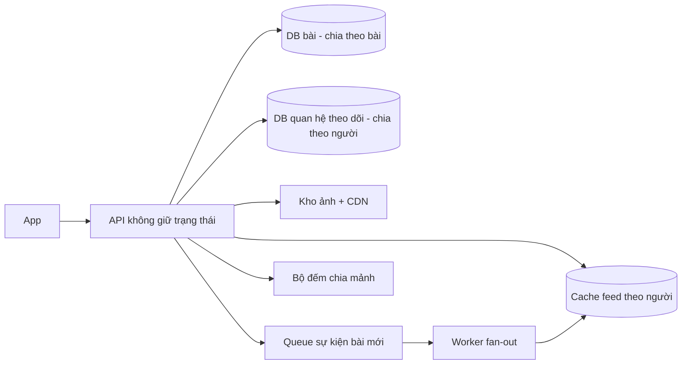

# Ví dụ lớn: feed mạng xã hội 10 triệu người dùng/ngày

Dùng ở bước 3, 5, 7 và 9 của `flow-system-design`, khi cần xem cách nghĩ ở quy mô lớn.

> **Kit hiếm khi gặp quy mô này — đừng áp cho app nhỏ.** App dưới vài chục nghìn người dùng/ngày: một DB, đọc feed bằng truy
> vấn "bài của người tôi theo dõi, mới nhất trước" có index + phân trang keyset là đủ. Mọi thành phần dưới đây đều có con số đòi nó.

## Mục lục
- Yêu cầu
- Ước lượng
- Kiến trúc tổng
- Fan-out khi ghi hay khi đọc
- Người nổi tiếng
- Cache
- Chia dữ liệu (shard)
- Bộ đếm nóng
- Queue
- Khi có sự cố
- Đánh đổi
- Đi từ nhỏ lên
- Nguồn

## Yêu cầu

- Xem feed các bài của người mình theo dõi, mới trước; đăng bài chữ + ảnh; thích, bình luận.
- 10 triệu người hoạt động/ngày (giả định đề bài); 95% lần mở feed dưới 300 ms; uptime 99,95%.
- Bài mới hiện trong feed người theo dõi trong vòng 10 s là chấp nhận (nhất quán chậm được) — đây là điều cho phép mọi tối ưu dưới.
- Số lượt thích được phép lệch vài giây; bài và ảnh không được mất (RPO vài phút).

## Ước lượng

Mọi hệ số là giả định của đề bài.

| Đại lượng | Phép tính | Kết quả |
|---|---|---|
| Lượt mở feed | 10 triệu × 10 lần/ngày | 100 triệu/ngày ≈ 1.160/s, cao điểm ×3 ≈ 3.500/s |
| Bài mới | 10% người đăng 1 bài/ngày | 1 triệu/ngày ≈ 12/s, cao điểm ≈ 35/s |
| Đọc:ghi | 100 triệu : 1 triệu | ~100:1 ⇒ cache và bản đọc phụ đáng làm |
| Ghi vào feed nếu đẩy khi đăng | 1 triệu bài × 200 người theo dõi trung bình | 200 triệu/ngày ≈ 2.300/s, cao điểm ≈ 7.000/s |
| Chữ bài | 1 triệu × 1 KB | ~1 GB/ngày ≈ 365 GB/năm |
| Ảnh | 30% bài có ảnh × 500 KB | ~150 GB/ngày ≈ 55 TB/năm ⇒ kho file + CDN |
| Feed giữ sẵn | 10 triệu người × 500 bài × 16 byte (ID + điểm) | ~80 GB trong bộ nhớ |
| Băng thông metadata | 3.500/s × 20 bài × 1 KB | ~70 MB/s lúc đông (ảnh đi qua CDN riêng) |
| Lượt thích bài nóng | 50.000 lượt/phút cho một bài | ~830 lần ghi/s vào **một** bộ đếm |

## Kiến trúc tổng

1. Đăng bài: API ghi bài vào DB bài, ảnh vào kho file, đẩy sự kiện "bài mới" vào Queue, trả lời ngay.
2. Worker fan-out đọc Queue, lấy danh sách người theo dõi từ DB quan hệ, chèn ID bài vào cache feed của từng người.
3. Mở feed: API đọc cache feed (danh sách ID), trộn bài của người nổi tiếng mình theo dõi, lấy nội dung bài theo lô, ảnh qua CDN.
4. Thích: API cộng vào một mảnh ngẫu nhiên của bộ đếm; số hiển thị là tổng các mảnh, cập nhật định kỳ.

## Fan-out khi ghi hay khi đọc

Fan-out (rải một bài tới feed của nhiều người).

| | Đẩy khi ghi (push) | Kéo khi đọc (pull) |
|---|---|---|
| Làm gì | Đăng bài ⇒ chèn ID vào feed từng người theo dõi | Mở feed ⇒ gom bài mới của mọi người mình theo dõi |
| Đọc | Rất rẻ: một lần đọc danh sách sẵn | Đắt: theo dõi 200 người ⇒ gom 200 nguồn, mỗi lần mở |
| Ghi | Đắt: 1 bài × số người theo dõi | Rẻ: ghi 1 bài |
| Hỏng ở | Người có hàng triệu người theo dõi | Người theo dõi hàng nghìn tài khoản; 3.500 lần mở/s |
| Hợp | Đọc gấp ~100 lần ghi — như ở đây | Ít người đọc, hoặc người đọc ít khi mở |

Ở đây chọn **lai**: đẩy khi ghi cho người thường, kéo khi đọc cho người nổi tiếng. Người không mở app 30 ngày ⇒ không đẩy,
dựng lại feed khi họ quay lại (tiết kiệm phần lớn lượt ghi — kinh nghiệm).

## Người nổi tiếng

- Một tài khoản 10 triệu người theo dõi: đẩy khi ghi = 10 triệu lần ghi cho một bài; ở 7.000 lần ghi/s mất ~24 phút và chặn
  hàng đợi của mọi người khác.
- Ngưỡng: trên ~10.000 người theo dõi (kinh nghiệm, chỉnh theo đo) ⇒ không đẩy; bài của họ lưu một chỗ, cache nóng, trộn vào
  feed lúc đọc.
- Mỗi người dùng theo dõi trung bình vài tài khoản nổi tiếng ⇒ lúc đọc chỉ gom thêm vài nguồn đã cache.

## Cache

- Cache feed theo người: danh sách ID bài, giữ 500 mục, ~80 GB ⇒ cụm cache bộ nhớ (ở quy mô này Redis có con số đòi).
- Cache nội dung bài theo ID: bài nóng đọc hàng triệu lần; nội dung ít đổi ⇒ TTL dài, xoá khi sửa bài.
- Cache bài người nổi tiếng: một khoá nóng ⇒ nhân bản khoá hoặc cache ngay trong bộ nhớ của từng máy API vài giây.
- Mất cache feed ⇒ dựng lại từ DB quan hệ + DB bài (chậm hơn, không sai) — cache là bản dẫn xuất.
- Tỉ lệ trúng cache < ~90% ⇒ xem lại TTL và cỡ (kinh nghiệm).

## Chia dữ liệu (shard)

- Lý do có con số: bài ~365 GB/năm chữ, quan hệ theo dõi 10 triệu × 200 = 2 tỷ dòng — vượt mốc "hàng chục–trăm triệu dòng,
  vài trăm GB" của một máy.
- DB bài chia theo ID bài (ID có thời gian để sắp xếp); DB quan hệ chia theo người theo dõi (đọc "tôi theo dõi ai" trong một mảnh)
  và một bản chia theo người được theo dõi cho fan-out.
- Giá: không nối bảng giữa các mảnh, giao dịch chỉ trong một mảnh, chia lại mảnh là việc lớn ⇒ ADR.
- Phân trang feed bằng keyset (nhớ ID bài cuối), không OFFSET.

## Bộ đếm nóng

- ~830 lần ghi/s vào một hàng ⇒ khoá hàng, nghẽn. Trên Cloudflare: KV giới hạn tần suất ghi cùng một khoá, Durable Objects có
  trần mềm request/giây mỗi đối tượng (tra bảng số liệu có ngày) ⇒ đều không chịu một khoá nóng.
- Chia mảnh: N mảnh (vd 32), mỗi lượt thích cộng vào một mảnh ngẫu nhiên; đọc = tổng, cache vài giây.
- Hoặc: ghi sự kiện thích vào Queue, gom theo lô mỗi vài giây rồi cộng một lần.
- Chống thích trùng: bảng (người, bài) `UNIQUE` — tách khỏi bộ đếm hiển thị.

## Queue

- Sự kiện "bài mới" ~35/s lúc đông, mỗi sự kiện sinh tới hàng nghìn lần ghi ⇒ tách khỏi request đăng bài.
- Giao ít nhất một lần ⇒ chèn vào feed idempotent (tập hợp theo ID bài, chèn trùng không sao).
- Tồn đọng tăng liên tục ⇒ cảnh báo; thêm worker fan-out; người nổi tiếng không đi qua đường này.
- Dead letter queue cho sự kiện lỗi lặp; phát lại được sau khi sửa.

## Khi có sự cố

| Thành phần | Hỏng | Người dùng thấy | Hệ thống làm |
|---|---|---|---|
| Cache feed | Mất một nút | Feed chậm hơn vài trăm ms | Dựng lại từ DB cho người đang mở |
| Fan-out | Tồn đọng | Bài mới hiện trễ | Ưu tiên người đang online; báo động khi trễ > 10 s |
| Một mảnh DB bài | Chết | Một phần bài không mở được | Bản sao lên thay; feed ẩn bài lỗi, không sập cả trang |
| Bộ đếm | Chậm | Số thích đứng yên | Hiện số cache cũ, gom lại sau |

## Đánh đổi

| Quyết định | Chọn | Đã loại | Vì sao | Xem lại khi |
|---|---|---|---|---|
| Feed | Lai đẩy/kéo | Chỉ đẩy, chỉ kéo | Đọc:ghi ~100:1 nhưng có người nổi tiếng | Phân bố người theo dõi đổi |
| Nhất quán | Chậm ≤ 10 s | Tức thì | Cho phép queue và cache | Tính năng cần tức thì (tin nhắn) |
| Bộ đếm | Chia mảnh | Một hàng | Một hàng chịu không nổi bài nóng | Tần suất ghi đo được thấp hơn nhiều |
| Lưu ảnh | Kho file + CDN | Trong DB | 55 TB/năm | — |

## Đi từ nhỏ lên

Không dựng bản trên ngay. Lộ trình mỗi bậc chỉ khi số đo chạm ngưỡng (kinh nghiệm, không phải số đo):
1. Một DB, truy vấn kéo khi đọc + index + keyset — tới vài chục nghìn người/ngày.
2. Cache trang feed vài chục giây; bản đọc phụ khi CPU DB > ~70% liên tục.
3. Queue + đẩy khi ghi khi mở feed chậm vượt mục tiêu dù đã cache.
4. Lai đẩy/kéo khi có tài khoản vượt ngưỡng người theo dõi.
5. Chia mảnh khi bảng tới hàng chục–trăm triệu dòng hoặc vài trăm GB.

## Nguồn

- https://github.com/proyecto26/system-design-skills (thang scale; có skill sharded-counters — mới thấy tên, chưa đọc)
- https://github.com/study8677/architecture-copilot (tín hiệu: CPU DB ~70%, cache trúng ~90%, shard ở hàng chục–trăm triệu dòng)
- https://github.com/pinchen147/system-design-skill (đọc:ghi ~100:1 mới nghĩ tới cache/replica; cao điểm 2–5× trung bình)
- https://use-the-index-luke.com/no-offset
- https://developers.cloudflare.com/kv/platform/limits/
- https://developers.cloudflare.com/durable-objects/platform/limits/
- https://developers.cloudflare.com/queues/platform/limits/
- Chưa có nguồn trong bộ nghiên cứu: mô hình fan-out đẩy/kéo/lai, ngưỡng người nổi tiếng, cỡ feed giữ sẵn, bỏ đẩy cho người
  không hoạt động, số mảnh bộ đếm.
