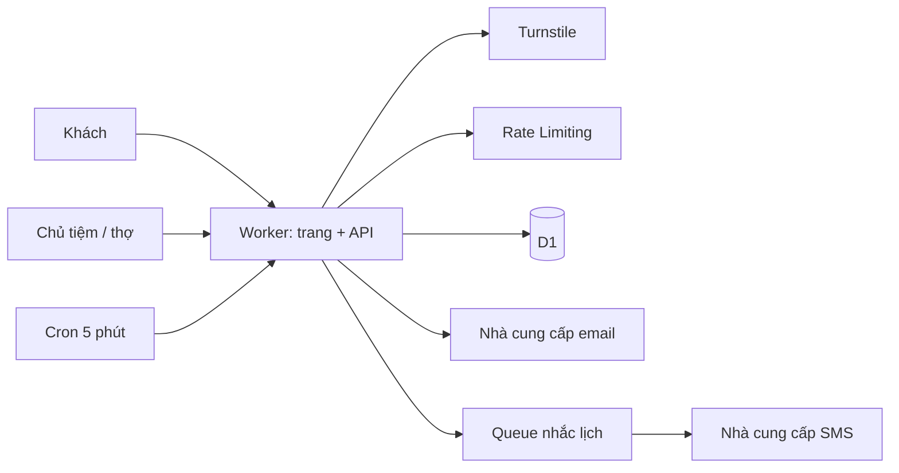

# Ví dụ nhỏ: app đặt lịch cho tiệm tóc

Dùng ở bước 1–10 của `flow-system-design`, khi cần xem một DESIGN.md đúng mức cho SaaS nhỏ.

## Mục lục
- Cách đọc
- Hạng quy mô (M)
- 1. Tóm tắt (M)
- 2. Bối cảnh, mục tiêu, không làm (M)
- 3. Yêu cầu phi chức năng (M)
- 4. Ước lượng (M)
- 5. Bản mẫu tính năng đã áp (M)
- 6. Kiến trúc tổng (M)
- 8. Dữ liệu (M)
- 10. Khi có sự cố (M)
- 15. Đánh đổi (M)
- 16. Lộ trình theo ngưỡng (M)
- 17. Rủi ro và câu hỏi mở (M)
- Soát

## Cách đọc

Chỉ có các mục bắt buộc (M), giữ đúng số mục của mẫu DESIGN.md; app mới thật thì viết thêm các mục còn lại.
Không có Redis, microservices, staging — vì không con số nào đòi. Giá: không ghi số ở đây, tra bảng số liệu có ngày.

## Hạng quy mô (M)

**MVP** — 30 tiệm, ~2.000 lượt đặt/ngày, tối đa ~3 request/giây lúc đông; một người vận hành không code.

## 1. Tóm tắt (M)

Khách mở trang của tiệm, chọn dịch vụ, thợ, giờ rồi đặt — không cần tài khoản. Chủ tiệm và thợ đăng nhập xem, sửa lịch.
App nhắn SMS nhắc khách 2 giờ trước hẹn. Chạy trên Cloudflare Workers + D1. Hạ tầng nằm trong phần gồm sẵn của gói Workers
trả phí tối thiểu; **SMS là khoản lớn nhất** (~60.000 tin/tháng). Rủi ro lớn nhất: hai khách đặt trùng một giờ, và bị lợi dụng gửi SMS.

## 2. Bối cảnh, mục tiêu, không làm (M)

- Mục tiêu: AC-01 đặt lịch không trùng · AC-02 nhắc SMS · AC-03 chủ tiệm quản lý lịch · AC-04 khách tự huỷ/đổi qua link.
- Không làm: thanh toán/đặt cọc, app điện thoại riêng, chương trình tích điểm, nhiều chi nhánh trong một tiệm.

## 3. Yêu cầu phi chức năng (M)

| Mục | Con số | Nguồn |
|---|---|---|
| Người dùng hoạt động/ngày | ~2.000 khách + ~240 nhân viên (30 tiệm × 8) | user nói; số nhân viên giả định |
| Độ trễ | 95% request xem giờ trống và đặt dưới 500 ms | giả định |
| Uptime | 99,5%/tháng (~3,6 giờ ngừng) — ngừng thì khách gọi điện | user nói |
| RPO / RTO | 1 giờ / 4 giờ | giả định, user đồng ý |
| Ngân sách/tháng | Hạ tầng gói tối thiểu; SMS theo số tin | user nói |
| Người vận hành | 1 người, không code | user nói |

**Giả định:** mỗi khách một lượt đặt; 70% khách đặt online, còn lại tiệm nhập tay; dịch vụ trung bình 45 phút; giờ mở cửa 8h–20h.

## 4. Ước lượng (M)

- Request/ngày: khách đặt 1.400 × 12 ≈ 17.000 · khách xem không đặt 1.000 × 6 = 6.000 · nhân viên 240 × 60 ≈ 14.400 ⇒ ~40.000.
- Trung bình 40.000 / 86.400 ≈ 0,46 request/giây. 80% dồn vào 12 giờ mở cửa: 32.000 / 43.200 ≈ 0,74/giây; giờ đông ×4 (giả định) ≈ **3/giây**.
- Đọc:ghi ≈ 20:1 (đa số là xem giờ trống).
- Hàng ghi/ngày: mỗi lượt ~8 hàng (1 lượt đặt + 3 ô 15 phút + 1 khách + 1 việc SMS + 2 cập nhật trạng thái) × 2 cho index
  (giả định) × 2.000 ≈ 32.000. Chiếm phần đáng kể trần ghi/ngày của D1 Free (tra bảng số liệu có ngày), mà Free **chặn truy vấn**
  khi chạm trần ⇒ dùng gói trả phí từ ngày đầu.
- Hàng đọc/ngày: ~20.000 lượt xem giờ × ~50 hàng ≈ 1 triệu.
- Dung lượng: ~1 KB/lượt × 730.000 lượt/năm ≈ 0,7 GB/năm; dọn ô giờ đã qua hằng đêm ⇒ còn khoảng nửa. Xa trần một DB D1.
- Băng thông: trang ~150 KB lần đầu (tĩnh, cache ở CDN), API ~2 KB/lần ⇒ không đáng kể.
- Chi phí tháng: Workers + D1 + Queues trong phần gồm sẵn gói tối thiểu · email (quên mật khẩu, vài trăm/tháng) trong gói miễn phí
  nhà cung cấp · **SMS 2.000 × 30 = 60.000 tin × giá một tin nội địa** (tra nhà cung cấp ngày viết) ⇒ gấp nhiều lần hạ tầng.

## 5. Bản mẫu tính năng đã áp (M)

| Loại | Làm ngay (→ AC/task) | Chừa chỗ (móc ở đâu) | Chưa làm (ngưỡng cần) |
|---|---|---|---|
| Đăng nhập chủ tiệm/thợ | Thư viện có sẵn (Better Auth trên D1 — kiểm docs), giới hạn thử sai theo tài khoản + IP, lỗi giống nhau khi sai mật khẩu/không có tài khoản, MFA cho chủ tiệm (AC-05) | Bảng thành viên có cột `role` | Đăng nhập Google khi > 30% chủ tiệm hỏi |
| Đặt chỗ chống trùng | Ô 15 phút có `UNIQUE(staff_id, slot_start)`; ghi lượt đặt + ô trong một lần ghi gộp; khoá chống gửi trùng `idem_key` (AC-01) | Cột `slot_minutes` theo tiệm | Bước 5 phút khi tiệm yêu cầu |
| Điểm vào công khai (trang đặt) | Turnstile ở nút Đặt; Rate Limiting binding theo IP; tối đa 3 lượt chưa đến/số điện thoại/tiệm, kiểm ở DB (AC-06) | — | OTP cho số mới khi tỉ lệ không đến > 10% trong 2 tuần |
| Gửi SMS nhắc | Chỉ gửi số +84; trần 200 tin/tiệm/ngày (~3× bình quân), chạm trần ⇒ ngừng + báo chủ tiệm; giành lượt trước khi gửi: chèn `sms_log` trạng thái `dang-gui` với `UNIQUE(booking_id, kind)`, chèn được mới gọi nhà cung cấp, xong đổi `da-gui`; nhà cung cấp từ chối rõ ràng (tin chưa đi) ⇒ đổi `loi` và nhả lượt để Queue thử lại; chỉ khi không rõ kết quả (hết giờ chờ, Worker chết giữa chừng) mới để `dang-gui` — gặp `dang-gui` quá 10 phút ⇒ không tự gửi lại, hiện "chưa rõ đã nhắc chưa" cho chủ tiệm (chấp nhận hiếm khi thiếu một tin thay vì gửi đôi; nhà cung cấp có khoá chống trùng thì truyền thêm) (AC-07) | Hàm bọc `sendReminder()` để thêm kênh khác | Kênh tin nhắn rẻ hơn khi phí SMS > 50% tổng phí tháng |
| Nhiều tiệm dùng chung | `tenant_id` trên mọi bảng, lấy từ phiên; mọi truy vấn qua lớp repo bắt buộc nhận tenant; test chéo tiệm (AC-08) | — | DB riêng khi một tiệm lớn đòi trong hợp đồng |

## 6. Kiến trúc tổng (M)

1. Khách mở trang tiệm → Worker đọc dịch vụ và giờ trống từ D1.
2. Khách bấm **Đặt** → Worker kiểm Turnstile và Rate Limiting → ghi lượt đặt + ô giờ vào D1 một lần; trùng ô ⇒ "Giờ này vừa có người đặt".
3. Chủ tiệm/thợ đăng nhập → Worker (thư viện đăng nhập, phiên trong D1) → xem, sửa lịch tiệm mình; quên mật khẩu ⇒ email.
4. Cron mỗi 5 phút gọi Worker → tìm lượt bắt đầu trong 2 giờ tới chưa nhắc → đẩy vào Queue.
5. Queue giao cho consumer (cùng Worker) → gửi SMS → ghi nhật ký gửi vào D1.

## 8. Dữ liệu (M)

| Bảng | Cột chính | Khoá / index |
|---|---|---|
| `tenants` | id, slug, name, tz | `UNIQUE(slug)` |
| `memberships` | user_id, tenant_id, role (`owner`/`staff`) | `PK(user_id, tenant_id)` |
| `staff`, `services` | id, tenant_id, name, duration_min | `(tenant_id)` |
| `customers` | id, tenant_id, phone_e164, name, deleted_at | `UNIQUE(tenant_id, phone_e164)` |
| `bookings` | id (ULID), tenant_id, staff_id, service_id, customer_id, start_at (UTC), status, idem_key, manage_token_hash | `UNIQUE(tenant_id, idem_key)`, `(tenant_id, start_at)`, `(staff_id, start_at)` |
| `booking_slots` | staff_id, slot_start, booking_id, tenant_id | `UNIQUE(staff_id, slot_start)` |
| `sms_log` | booking_id, kind, status, provider_msg_id | `UNIQUE(booking_id, kind)` |

- Quyền: D1 không có RLS ⇒ tenant ID chỉ lấy từ phiên; nhân viên chỉ thấy tiệm mình; khách chỉ thấy lượt của mình qua link có
  token ngẫu nhiên (lưu băm, hết hạn sau giờ hẹn).
- Giữ: lượt đặt 2 năm; ô giờ đã qua xoá hằng đêm; khách yêu cầu xoá ⇒ ẩn danh số điện thoại, giữ thống kê.
- Giờ lưu UTC, hiển thị theo `tenants.tz`. Migration kiểu nở rồi co, trong git.

## 10. Khi có sự cố (M)

| Thành phần | Hỏng kiểu gì | Người dùng thấy gì | Hệ thống làm gì |
|---|---|---|---|
| D1 | Chậm, lỗi ghi | "Chưa đặt được, thử lại" — chọn lựa vẫn giữ | Timeout 5 s; không tự thử lại ghi đặt (đã có `idem_key` nếu khách bấm lại) |
| Nhà cung cấp SMS | 5xx, hết hạn mức | Khách không nhận nhắc; màn chủ tiệm hiện "chưa gửi nhắc" | Queue thử lại có trần, rồi vào dead letter queue + cảnh báo |
| Queue / Cron | Không chạy | Nhắc trễ | Lần chạy sau quét lại lượt chưa nhắc; giành lượt `dang-gui` trước khi gửi nên chạy lại không gửi đôi; kẹt `dang-gui` ⇒ báo chủ tiệm, không tự gửi lại |
| Turnstile | Không tải được | Nút Đặt báo "thử lại" | Không bỏ qua kiểm; tiệm vẫn nhận đặt qua điện thoại |
| Nhà cung cấp email | Lỗi | Không nhận mail quên mật khẩu | Báo "thử lại sau", chủ tiệm khác trong tiệm vẫn vào được |
| Bản phát hành mới | Lỗi 500 | Không đặt được | Quay lại bản trước (`flow-rollback`); dữ liệu: D1 Time Travel |

## 15. Đánh đổi (M)

| Quyết định | Chọn | Đã loại | Vì sao | Xem lại khi |
|---|---|---|---|---|
| Nơi lưu | D1 | Supabase Postgres | Stack kit, tải nhỏ, khôi phục về mốc theo phút; mất RLS ⇒ bù bằng lớp repo + test | Báo cáo nặng, hoặc DB tới nửa trần cỡ một DB D1 |
| Chống trùng | Bảng ô 15 phút + `UNIQUE` | Truy vấn chồng giờ rồi ghi | DB tự ép, không có chạy đua giữa hai request | Tiệm cần bước 5 phút |
| Xác minh khách | Không OTP, chặn bằng Turnstile + hạn mức | OTP mỗi lần đặt | Ít bước cho khách; OTP gấp đôi số SMS | Tỉ lệ không đến > 10% trong 2 tuần |
| Nhắc lịch | Cron 5 phút + Queue | Báo thức riêng từng lượt (Durable Objects) | Một chỗ xem, đơn giản | Cần nhắc chính xác từng phút |
| Tách dữ liệu tiệm | Một DB, cột `tenant_id` | DB riêng từng tiệm | 30 tiệm, một lần migration | > 1.000 tiệm hoặc hợp đồng đòi |

Mô hình ô giờ và cách tách tiệm khó đảo ngược ⇒ ADR-001.

## 16. Lộ trình theo ngưỡng (M)

| Khi (ngưỡng đo được) | Làm |
|---|---|
| 95% request xem giờ trống > 500 ms liên tục 1 tuần | Cache giờ trống trong KV 30 s theo (tiệm, ngày) |
| Tỉ lệ không đến > 10% trong 2 tuần, hoặc có báo đặt ảo | OTP cho số điện thoại mới |
| Phí SMS > 50% tổng phí tháng | Thêm kênh tin nhắn rẻ hơn qua hàm bọc, SMS làm dự phòng |
| > 300 tiệm hoặc DB tới nửa trần cỡ một DB D1 | Xem lại nơi lưu (Postgres) — ADR mới |
| Có người vận hành thứ hai, hoặc > 100 tiệm | Thêm staging |

## 17. Rủi ro và câu hỏi mở (M)

- Rủi ro: bị lợi dụng ô số điện thoại để gửi SMS (đã chặn bằng +84, hạn mức số, trần/tiệm); sai múi giờ (đã lưu UTC).
- Hỏi user: "Khách huỷ sát giờ có bị hạn chế đặt lần sau không?" → khuyên: không ở bản đầu, chỉ đếm.
- Hỏi user: "Nhà cung cấp SMS nào, giá một tin bao nhiêu?" → cần trước khi chốt phí tháng.

## Soát

Tự soát bằng danh sách soát thiết kế: nhận #8 (thêm trần SMS/tiệm), #11 (`UNIQUE` cho `sms_log`); bác #23 cho Queue —
có lý do: 60.000 tin/tháng cần thử lại tách khỏi request.

Nguồn: https://developers.cloudflare.com/d1/platform/pricing/ · https://developers.cloudflare.com/d1/reference/time-travel/ ·
https://developers.cloudflare.com/workers/runtime-apis/bindings/rate-limit/ · https://www.twilio.com/docs/verify/preventing-toll-fraud ·
https://github.com/OWASP/ASVS/blob/master/5.0/en/0x11-V2-Validation-and-Business-Logic.md (2.3.4 chống đặt trùng) ·
https://cheatsheetseries.owasp.org/cheatsheets/Multi_Tenant_Security_Cheat_Sheet.html · https://docs.stripe.com/api/idempotent_requests.
Chưa có nguồn: D1 ghi gộp chạy như một giao dịch, Better Auth trên D1, giá SMS nội địa.
